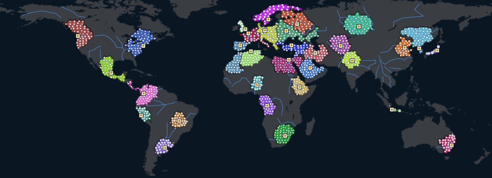
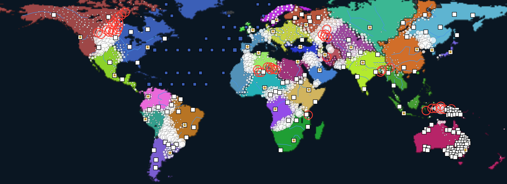
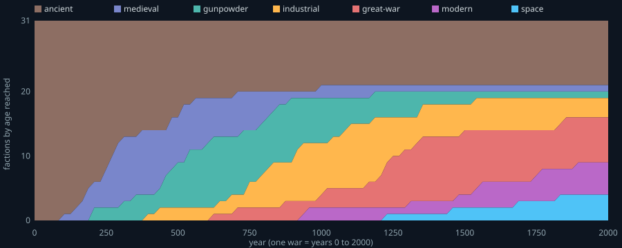

# Ridgeline

A research environment for real-time strategy played by AI agents. Thirty-one factions start on a real-world map in the year 0 and run their own economy, research, diplomacy and armies for 2,000 years. Every faction is controlled by a policy that a language model wrote by itself, reviewed after each war, and rewrote.

The long-term goal is an RTS in which an AI commander beats even a human who has AI help: many engagements at once, across a long front, with tens of thousands of individually simulated units.

[한국어 README](README.ko.md)


*Year 0: thirty-one factions around real capital cities. Dots are units, squares are supply depots, stars are capitals.*


*Year 2000 of the same war. Red rings are assaults in progress.*

## What it is

- **Province-level economy, unit-level fighting.** Income, manpower, supply, forts and fog work per province (about 3,650 land provinces and 476 sea zones). Units are not counters: each one has a position, strength, readiness, experience, morale and suppression, moves and fires on its own, and a province changes hands only when someone holds its key point.
- **A real map.** Coastlines come from Natural Earth. Mountain ranges, deserts, tundra, about 60 major rivers, cold winters, jungle fever and strategic resource fields (steel, oil, rare metals, coal, rubber) are placed where they are in the world.
- **2,000 years in one war.** Everyone starts with spearmen, levies and runners. A tree of 46 discoveries leads through seven ages (ancient, medieval, gunpowder, industrial, great-war, modern, space) and opens 19 kinds of units, including warships, submarines, carriers, fighters, bombers, satellites and conventional missiles.
- **Agents choose blind.** How good a faction's own version of a new model is, and how deep each upgrade line goes, is hidden and differs per faction and per war. Agents find out only by paying.
- **Fog per faction.** A faction sees only what its own units and allies see. The map itself is unknown until explored.
- **No strategy is hand-coded.** The engine supplies mechanics, limits and tools. When to expand, research, trade, sign a pact, build a port or attack is decided by each faction's own agent.

## How agents play

Each faction has a policy file with one function, `tick(api)`, called every six game hours. `api` gives the faction's own view (units, provinces it has seen, budget, the discovery tree, diplomacy, estimates of enemy strength) and `api.cmd(...)` issues orders such as `move`, `prepare`, `recruit`, `research`, `refit`, `offer`, `depot`.

`tools/league.py` runs the learning loop:

1. Every faction's model reads the rules briefing and writes a policy from scratch.
2. All policies fight a war.
3. Each model receives a review of its own war (what it ordered, what was refused and why, what it won and lost) and rewrites its policy. It also sends feedback on what would make the game easier to control.

Policies are written by Claude Haiku or Claude Opus. A local model behind an OpenAI-compatible endpoint can be used instead. There is no model call during a war, so a 2,000-year war costs nothing to run.

## What happened so far


*Generation 9, first war under the 2,000-year rules: how many of the 31 factions had reached each age.*

Honest summary of the latest complete war (generation 9, rules v11):

- Four factions reached the space age (the first in the year 1225) and two launched satellites. Nine never left the ancient age, mostly because of bugs in their own policies.
- No faction built a single ship, aircraft or missile, although 17 knew galleys and 11 knew flight. The policies had only ever been reviewed on a short war and did not use them.
- Wars were rare: 295 real assaults in 2,000 years, 97 won, 166 non-aggression pacts at the end, two factions eliminated.

Changes made in response (rules v12, in the repository now):

- Ages differ far more in power (ancient 0.06 of modern, space 1.5). In a controlled test five modern infantry units clear thirty fortified spearmen almost without loss.
- Knowledge seeps in from neighbours. A discovery that factions you have met already hold fills up a little every day, and the filled share comes off both its price and its research time.
- The calendar can be stretched so that one game day is under a year (`--calendar`).

Earlier findings are kept in the Korean README: why fronts were static, why agents stopped attacking once pacts existed, and what was changed each time.

## Quick start

Python 3.10 or newer, standard library only. numpy is needed only by the replay recorder.

```bash
python tests/test_core.py                       # rule tests
python -m ridgeline.match 7 out.json --small --two   # 300 provinces, two factions, about 10 seconds
python tools/era_gap.py                         # what one age is worth in an assault

# a full 2,000-year war with the latest league policies, then a phone-friendly replay page
python tools/record_war.py --seed 1 --hours 9216 --pol-dir runs/league_world --every 2 --out runs/replays/war
python tools/make_mobile.py runs/replays/war war.html --step 24 --title "Ridgeline"
```

The engine is pure Python. Under [PyPy](https://pypy.org) the same code runs about twice as fast (`pypy3 tools/record_war.py ...`); results then differ slightly from CPython for the same seed.

To let models write policies (this calls models through the `claude` command-line tool, which must be installed and signed in; it costs money, about 4 to 5 US dollars per generation for 31 factions):

```bash
python tools/league.py --world 1.0 --gens 1 --seeds 1 --max-ticks 600 --next-ticks 9216 \
    --models "$(cat runs/league_world/models.txt)" --out runs/league_world --jobs 6 --resume
```

## Layout

| Path | What |
|---|---|
| `ridgeline/engine.py` | the simulation: economy, supply, movement, combat, diplomacy |
| `ridgeline/ages.py` | the 2,000-year discovery tree and how knowledge spreads |
| `ridgeline/worldgen.py` | the world map, rivers, resource fields, sea zones |
| `ridgeline/iface.py` | what an agent sees and can order; the rules briefing |
| `ridgeline/data.py` | every number in the rules |
| `tools/league.py` | the write, fight, review, rewrite loop |
| `tools/record_war.py`, `tools/make_mobile.py` | record a war and build a replay page |
| `runs/league_world/` | every policy each faction wrote, generation by generation, with its own notes and feedback |
| `GRAPHICS.md` | the WebGL replay viewer |

## Known limits

- The calendar is compressed; by default one game day stands for about five years.
- Carriers are modelled as long-range ships, troop transports are abstract, there are no nuclear weapons, and the map does not wrap across the Pacific.
- Runs are not bit-identical across processes unless `PYTHONHASHSEED=0` is set.
- Above roughly 100,000 units an hour of game time takes more than a second.

## Licence

MIT. Coastline data: Natural Earth (public domain).
